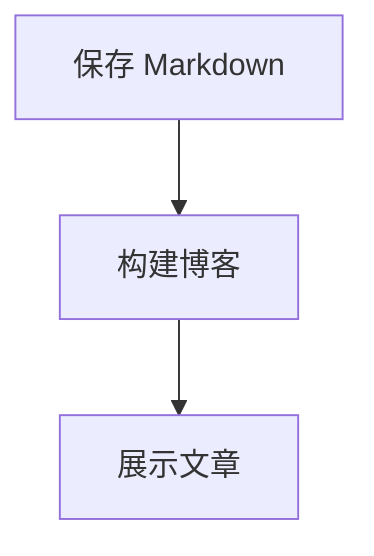

# devin-my-blog

站点标题为 `devin, my blog.`。用 Vite + React + TypeScript + Tailwind CSS 实现的个人博客，使用 React Router 管理路由。视觉参考 [tomaszgil.me](https://tomaszgil.me/) 的 REA 解析：满屏首页、全屏菜单、循环主题、百叶窗与树影光效。

## 运行

需要 Node.js 22.22+。本地开发时将内容仓库与网站代码放在同一个父目录：

```text
Projects/
├── devin-my-blog/          # 当前网站代码
└── devin-blog-content/     # 文章、配图、分类与精选
```

内容仓库：[wzh-devin/devin-blog-content](https://github.com/wzh-devin/devin-blog-content)。开发服务和内容导出读取本地文件；网站生产构建不需要内容仓库。浏览器启动时请求 `/content/index.json`，文章和 Markdown 页面正文按路由加载；内容仓库更新不会重新构建网站。开发预览在保存或拉取内容后自动刷新。

```sh
npm ci
npm run dev      # http://127.0.0.1:5173
npm test         # 路由、筛选、主题和输入边界
npm run build    # 类型检查 + 网站程序构建，不读取文章
npm run content:build # 校验并导出独立内容到 content-dist/content/
npm run preview
npm run format       # Prettier 格式化
npm run format:check # 格式检查
npm run lint         # Oxlint 静态检查
npm run lint:fix     # 修复支持自动修复的问题
npm run check        # 格式、静态检查、测试与生产构建
```

## 页面

- `/`：左上简介；桌面左侧最近三篇文章、右侧精选文章时间索引，窄屏依次排列；时区时钟位于圆环中心，展开详情时隐藏，返回时恢复；保留查看全部入口与满屏光影。
- Menu 中的 About、Work、Uses、Links、Writing 对应独立页面。
- `/writing`：原站式文字入口和最近三篇文章。
- `/archive`：全部文章、分类、搜索和空结果恢复。
- `/writing/:slug`：保留原有文章详情路径、目录和代码块。

点击主题按钮，依次循环 Dawn → Sunrise → Day → Sunset → Dusk → Night。主题会改变颜色与窗影几何，偏好保存在浏览器；旧版 morning 自动迁移为 sunrise。

通过可见链接与按钮操作，无全局字母或斜杠快捷键。保留 Tab 导航与 Escape 关闭菜单；菜单由原生 dialog 管理焦点，减少动态偏好会暂停 CSS 与 SVG 风动。

首页时间环复用用户提供的 Radial Timeline 动画，定位为精选文章的时间索引。按内容仓库中的精选清单展示文章的短标题与年月，按发布日期顺时针排列，以非等距编辑排版保留疏密和留白；角度不表示真实日期间隔。点击节点展开原文标题、日期、分类、阅读时长与摘要，通过“阅读全文”进入正文；返回收回圆环并恢复时钟、焦点与转动。圆心保留时钟，去掉月份统计与年份切换。圆环初始对齐真实秒数，以每秒 6° 匀速顺时针转动，一分钟一圈；标签保持正向、数字时钟固定。悬浮文章标题时暂停，移开后从暂停角度继续；展开预览时暂停，返回通常对齐当前秒数后恢复。触摸不会触发悬浮暂停，减少动态模式保持静止。发布新文章只更新最近文章与 Archive，精选内容需手动调整，不会自动填满圆环。圆环最大 680px，桌面在顶栏下方的可视区域垂直居中，左侧文章列表的中心与圆心对齐；简介独立位于左上。滚轮和触摸滑动正常滚动页面。Framer Motion 使用来源版本 12.36.0，减少动态时立即切换。接入范围见 [SOURCE.md](src/components/radial-timeline/SOURCE.md)。

## 修改内容

`devin-blog-content/config/site.json` 控制署名、品牌、首页简介和文案；浏览器加载内容后同步页面标题与描述。`timeZone` 用于文章日期（示例值 Asia/Shanghai），首页时钟始终跟随访客浏览器当前时区。`src/config/site.ts` 仅保留兼容导出，不再维护内容。下方通过 [GeoJS](https://www.geojs.io/docs/v1/endpoints/geo/) 按 IP 大致识别城市与国家，不请求精确定位、不显示或持久化经纬度；代理可能影响城市。页面内查询一次、5 秒超时，失败显示“位置暂不可用”且时钟正常；切换网络后刷新更新。文章入口在 `src/features/articles/data.ts`，数据由内容发布流程导出为 JSON，在浏览器运行时读取；类型和筛选在同目录的 `model/` 中。署名仍为示例，请按实际资料修改。未提供真实联系方式，因此没有生成虚构邮箱或社交账号。

### 内容目录与发布位置

| 内容仓库位置                        | 网站位置                               |
| ----------------------------------- | -------------------------------------- |
| `posts/development/<slug>/index.md` | `/writing/<slug>`，归档“开发”分类      |
| `posts/design/<slug>/index.md`      | `/writing/<slug>`，归档“设计”分类      |
| `posts/thoughts/<slug>/index.md`    | `/writing/<slug>`，归档“随想”分类      |
| `config/site.json`                  | 品牌、署名、首页两行介绍与最近文章文案 |
| `config/navigation.json`            | Menu 左侧导航、顺序与显隐              |
| `config/menu.json`                  | Menu 右侧介绍、链接与页脚              |
| `pages/about/index.md`              | `/about` 正文、标题、提示与链接        |
| `pages/work/index.json`             | `/work` 项目列表                       |
| `pages/uses/index.json`             | `/uses` 工具列表                       |
| `pages/links/index.json`            | `/links`，分组链接列表                 |
| `pages/<slug>/index.md`             | 新的 `/<slug>` 独立页面                |
| `config/categories.json`            | Archive 分类筛选，数组顺序就是显示顺序 |
| `config/featured.json`              | 首页圆环精选，按文章日期排列           |
| `drafts/`                           | 不读取、不输出页面或配图               |

每篇文章的 `index.md` 开头填写 `title`、`date: "YYYY-MM-DD"`、`description`，正文使用 Markdown。配图放在本篇目录内，以 `` 引用。独占一段的配图下方会自动显示原始文件名与后缀（例如 `example.webp`），不显示构建哈希；内联图片保持原样。远程配图按 URL 路径提取文件名，不读取查询参数。文章间可使用指向另一个已发布 `index.md` 的相对链接，构建时会转换为 `/writing/<slug>`；其他站内页面使用 `/archive` 等绝对站内路径。原始 HTML 和 JSX 作为文字显示，不执行脚本。

新增分类时，在 `categories.json` 添加 `{ "id": "reading", "label": "阅读" }`，再将文章放到 `posts/reading/<slug>/index.md`。网站自动添加“全部”并保留空分类；全站菜单单独通过 `config/navigation.json` 维护，不影响文章分类。

文章按发布日期降序展示，首页和 Writing 取最近三篇。圆环清单只引用已发布文章，最多六篇；移除精选不会删除文章。阅读时长按正文字符数估算。移回草稿前，先删除对应精选引用。

无效 JSON/YAML、重复文章标识、错误日期、未登记分类、失效精选和越界或缺失配图会明确报错并阻止内容发布；不会回退到旧示例数据。没有已发布文章时允许空列表。

正文的 `##`、`###` 等标题会自动进入“本文目录”，按实际标题层级嵌套缩进，点击后定位到对应标题；跳级时归入最近的上级标题，不补造空章节。

### 站点配置和独立页面

配置模板见下方“内容仓库初始化模板”，详细目录与字段说明见 [内容仓库 README](https://github.com/wzh-devin/devin-blog-content/blob/main/README.md)。网站只读取内容仓库中的 `config/` 与 `pages/`，不内置另一份配置，也不在运行时解析 README。站点、导航、菜单和内置页面文件必须存在；缺少必要文件或字段会阻止内容导出并指出位置；浏览器请求失败显示重试入口，不使用内置示例。

允许显式清空：`navigation.json` 为 `[]` 隐藏全部菜单，`sectionList: []` 清空页面分组，`entryList: []` 清空分组条目，`linkList: []` 清空操作链接。条目的 `year`、`linkList` 和 Markdown 的 `description`、`notice`、`linkList` 是可选字段；其余以模板及校验提示为准。

例如新增 `pages/notes/index.md`（frontmatter 填 `title`，可选 `description`、`notice`、`linkList`），再在 `config/navigation.json` 添加 `{ "label": "Notes", "href": "/notes" }`。页面自动映射 `/notes`，不必修改前端路由。设置 `visible: false` 只隐藏菜单；已有页面依然可以直接访问。可见项按数组顺序自动编号，菜单名称与页面标题独立。

About 与自定义页面使用 Markdown，图片放在自身目录中；Work/Uses/Links 共用 JSON 列表模板。每个条目支持可选 `linkList: [{ label, href }]`，可同时展示官网、下载等多个链接，支持安装包直链；省略或 `[]` 保持纯名称和描述。Markdown 正文里的相对页面/文章链接会自动映射网站路径；配置中的链接使用 `/about` 等站内绝对路径或 HTTP(S)、mailto、tel。系统路径 `/`、`/writing`、`/archive`、`/writing/:slug` 和资源目录不能被自定义页面占用；`about`、`work`、`uses`、`links` 分别使用规定格式。

无效配置、未知字段、危险链接、失效站内配置链接、页面冲突会包含文件位置并阻断内容导出。保存/新增/删除配置、页面和配图后，开发服务自动刷新；线上由内容仓库工作流独立发布，刷新页面后读取最新索引。

### 代码高亮与 Mermaid 图表

正文继续使用 `markdown-to-jsx`。`highlight.js` 和 `beautiful-mermaid` 仅在内容导出端运行，不进入浏览器 JavaScript；无需 CDN 或在线图表服务。

代码围栏标明语言即可高亮，例如 `typescript`、`ts`、`javascript`、`json`、`bash`、`go`、`python`、`sql` 等 common 构建支持的语言；无语言或未知语言保持纯文本。代码块右上角显示语言名（未标记时为 `text`）和“复制”按钮，复制原文并保留缩进与换行；成功显示“已复制”，失败可重试。复制使用浏览器 Clipboard API，需要 HTTPS 或 localhost。代码块沿用网站现有字体、背景、间距和主题色。

使用 Mermaid 围栏可以生成图表：

````markdown

````

当前支持流程图、状态图、时序图、类图、ER 图和 XY 图表，采用 `beautiful-mermaid` 支持的 Mermaid 语法子集。图表生成浅色/深色两份透明 SVG，随网站主题显示；右上角标记 `mermaid` 并可复制图表源码，源码不在页面展开。这是静态图表，不执行图表里的交互脚本。语法有误或类型不支持时会提示并保留源码，不影响其余正文。图表与配图共用内容摘要、开发监听和生产资源输出。

Work、Uses、Links 的 JSON 结构完全相同：`{ title, introduction, sectionList: [{ title, entryList: [{ name, description, year?, linkList? }] }] }`。页面仅内容不同，不再支持 `projectList`、`toolList` 或单独 `href` 的旧格式；现有示例已迁移。`year` 可选，未配置不显示；`linkList` 可包含多个官网、下载、源码或演示入口。原 Links Markdown 示例已移到 `drafts/links-legacy/index.md` 保留。

### 使用其他内容目录

默认路径为 `../devin-blog-content`。其他位置可在网站根目录的 `.env.local` 中设置：

```dotenv
BLOG_CONTENT_DIR=/absolute/path/to/devin-blog-content
```

相对路径以博客代码仓库根目录为基准。这个变量用于开发和 `content:build`，不进入浏览器；修改后重启开发服务。网站生产构建不要求该目录存在，文章和配图仅输出到 `content-dist/`，不会进入 `dist/` 或网站镜像。线上只保留生成文件，不保存源码仓库或 GitHub 凭据。

树影资源来源记录于 `public/ASSETS.md`；字体为自托管的 Geist，不需要运行时远程字体服务。没有复制参考作者的 Logo 或文章。

## 内容仓库初始化模板

以下示例仅在 README 中维护，复制到 `devin-blog-content` 中对应的位置后编辑。实际配置只由内容仓库管理，网站代码没有内容回退文件。Work、Uses、Links 的结构相同，下面只展示各自内容的区别。

### `config/site.json`

```json
{
  "name": "Devin",
  "siteName": "Devin, my blog.",
  "description": "关于开发、设计，以及生活里那些微小的发现。",
  "introLineList": ["记录关于代码、设计与生活，", "把一路上的探索、想法，慢慢写下来。"],
  "timeZone": "Asia/Shanghai",
  "home": {
    "recentTitle": "Recent writing",
    "viewAllLabel": "View all"
  }
}
```

### `config/navigation.json`

```json
[
  {
    "label": "Home",
    "href": "/"
  },
  {
    "label": "About",
    "href": "/about"
  },
  {
    "label": "Work",
    "href": "/work"
  },
  {
    "label": "Uses",
    "href": "/uses"
  },
  {
    "label": "Writing",
    "href": "/writing"
  }
]
```

### `config/menu.json`

```json
{
  "eyebrow": "A little hello",
  "title": "Keep in touch",
  "description": "这个小站记录关于开发、设计与日常的想法。你可以从一篇文字开始，慢慢认识这里。",
  "linkList": [
    {
      "label": "Writing",
      "href": "/writing"
    },
    {
      "label": "About",
      "href": "/about"
    }
  ],
  "footer": {
    "label": "Last updated",
    "text": "Copyright / {year}"
  }
}
```

### `pages/about/index.md`

```markdown
---
title: About
description: 写代码，也写一些文字。对如何把东西做好，始终保持好奇。
linkList:
  - label: Explore my writing
    href: /writing
---

写代码，也写一些文字。对如何把东西做好，始终保持好奇。

这个博客用来记录开发中的思考、设计里的小细节，以及日常生活中偶然发现的美好。不追逐热点，也不急着给出标准答案。

## A little space on the internet

希望这里像一张靠窗的书桌：简单、安静，有一点阳光。打开一篇文章，就能安心读一会儿。

比起完整的结论，更想保留探索的过程。那些想明白的、还没想明白的，都可以在这里慢慢展开。
```

### `pages/work/index.json`

```json
{
  "title": "Work",
  "introduction": "一些正在构建的东西，从想法开始，在细节里慢慢成形。",
  "sectionList": [
    {
      "title": "Current project",
      "entryList": [
        {
          "year": "2026",
          "description": "这个小站。用 Vite、TypeScript 与 Tailwind CSS 搭建，记录技术、设计与日常思考。",
          "linkList": [
            {
              "label": "查看项目",
              "href": "/archive"
            }
          ],
          "name": "Devin, my blog."
        }
      ]
    }
  ]
}
```

### `pages/uses/index.json`

```json
{
  "title": "Uses",
  "introduction": "让这个小站运行起来的工具。保持简单，把精力留给内容。",
  "sectionList": [
    {
      "title": "Built with",
      "entryList": [
        {
          "name": "Vite",
          "description": "开发服务与静态构建。",
          "linkList": [
            {
              "label": "官网",
              "href": "https://vite.dev/"
            }
          ]
        },
        {
          "name": "TypeScript",
          "description": "让内容、路由和交互有清楚的类型约定。",
          "linkList": [
            {
              "label": "官网",
              "href": "https://www.typescriptlang.org/"
            }
          ]
        },
        {
          "name": "Tailwind CSS",
          "description": "布局工具类与主题样式。",
          "linkList": [
            {
              "label": "官网",
              "href": "https://tailwindcss.com/"
            }
          ]
        },
        {
          "name": "Geist",
          "description": "自托管的 Sans 与 Mono 字体。",
          "linkList": [
            {
              "label": "官网",
              "href": "https://vercel.com/font"
            },
            {
              "label": "下载",
              "href": "https://github.com/vercel/geist-font/releases"
            }
          ]
        }
      ]
    }
  ]
}
```

### `pages/links/index.json`

```json
{
  "title": "Links",
  "introduction": "一些常去的地方，和想留下的链接。",
  "sectionList": [
    {
      "title": "阅读与探索",
      "entryList": [
        {
          "name": "GitHub",
          "description": "代码和开源项目。",
          "linkList": [
            {
              "label": "官网",
              "href": "https://github.com/"
            }
          ]
        },
        {
          "name": "MDN Web Docs",
          "description": "Web 开发参考。",
          "linkList": [
            {
              "label": "官网",
              "href": "https://developer.mozilla.org/zh-CN/"
            }
          ]
        }
      ]
    },
    {
      "title": "在这里",
      "entryList": [
        {
          "name": "最近的文字",
          "description": "看看最近写下的文章。",
          "linkList": [
            {
              "label": "阅读",
              "href": "/writing"
            }
          ]
        },
        {
          "name": "关于这个小站",
          "description": "从一段介绍开始认识这里。",
          "linkList": [
            {
              "label": "了解更多",
              "href": "/about"
            }
          ]
        }
      ]
    }
  ]
}
```

## 项目结构

```text
src/
├── main.tsx                    # React 与 RouterProvider 入口
├── app/
│   ├── app.tsx                 # 根布局、Outlet 与共享状态
│   ├── router/                 # React Router 配置、文章 loader、页面元数据
│   └── layout/                 # site-header、site-menu、ambient-light
├── pages/                      # home、about、work、uses、writing、archive、article、not-found
│   └── archive/
│       ├── index.tsx
│       ├── archive.css
│       └── components/search-toolbar/index.tsx
├── features/
│   ├── articles/               # 内容入口、模型、筛选 Hook、共享文章列表和精选时间索引
│   └── theme/                  # 六主题模型、主题 Hook、切换按钮
├── components/                 # icon、brand、text-link、page-heading、radial-timeline
├── hooks/                      # 跨模块共享的浏览器能力 Hook
├── content/                    # 运行时内容入口与共享 Markdown / 列表组件
├── config/                     # 网站资料与导航兼容入口
├── lib/                        # 公共日期格式化
└── styles/                     # 全局样式入口、主题变量、基础样式及公共响应式规则
```

组件和页面各自建立目录，以 `index.tsx` 公开；业务模块以 `index.ts` 显式导出。小组件直接在入口实现，复杂模块将内部逻辑放在同目录。模块内部直接引用实现，外部使用公开入口，避免从全局桶文件导入所有组件。

页面专用组件放在页面的 `components/` 中，例如首页时钟与归档搜索栏。跨页面业务组件放在所属 `features/` 中，例如 Home、Writing 与 Archive 共用文章列表。无业务含义的基础组件放在 `src/components/`，新增代码先检查已有实现。

`components/radial-timeline/` 通过 `index.tsx` 公开圆环，节点、圆心内容与详情由调用方传入，内部维护坐标、容器测量与展开动画。精选引用与预览展示位于 `features/articles/components/article-timeline/`，复用 TextLink、日期格式化、主题变量、Icon 和 useReducedMotion。修改内容仓库的 `config/featured.json` 更换精选 slug 与短标题，最多六篇；标题、摘要、首次发布日期和阅读时长继续从现有文章数据读取。节点按 `date` 排序，排版位置单独维护，不增加重复正文数据。

React Router 的 `createBrowserRouter` 集中维护路由，`Outlet` 渲染页面，`Link` 处理站内跳转，`ScrollRestoration` 恢复历史滚动。菜单由内容配置提供，编号共用 `src/config/navigation.ts`；系统路由独立保留，自定义页面按目录增加。根布局保留筛选状态，页面切换不会清空条件。React 负责文本转义，避免拼接 HTML。

专有 CSS 与页面或组件就近存放，由 `src/styles/global.css` 统一装配（独立页面附加自己的局部样式），按“变量、基础、专有、公共响应式”的顺序保持覆盖关系。公共颜色、字体、排版和列表规则仅维护一份。

## 代码约束

Prettier 配置在 `.prettierrc.json`，Oxlint 配置在 `.oxlintrc.json`。Prettier 负责格式，Oxlint 检查 TypeScript、React、Hooks 与可访问性问题；`npm run check` 是交付前检查入口。生成产物、静态资源及本地知识库不参与格式化。

## 后续开发

当前版本是后续开发的视觉基准，具体约定见 [DESIGN.md](DESIGN.md)；项目规则见 [AGENTS.md](AGENTS.md)。新增页面沿用现有字体、间距、内容外框、全屏菜单和六时段光影，优先复用现有样式与原生交互。

旧版备份、截图、检查脚本和设计记录已清理，当前光影资源、REA 参考证据及当前版本检查保留。项目内不再提供旧版归档恢复。

## Docker Compose 与独立发布

网站与内容分别发布：

| 仓库               | main 推送时执行                            | 服务器变化                            |
| ------------------ | ------------------------------------------ | ------------------------------------- |
| devin-my-blog      | 检查并构建网站程序，打包 Docker 镜像       | Compose 更新网站容器；保留内容目录    |
| devin-blog-content | 校验文章、配置、页面，生成 JSON 与摘要资源 | 只更新 content/；不构建网站或重启容器 |

网站工作流为 [.github/workflows/deploy.yml](.github/workflows/deploy.yml)。内容工作流为内容仓库的 `.github/workflows/publish.yml`。手动运行默认 `deploy=false`，只生成产物；明确勾选才发布。内容发布不触发网站工作流，不需要 `CONTENT_READ_TOKEN` 或 `SITE_DISPATCH_TOKEN`。

### 源码、镜像与内容目录

借鉴 [Hexo 的目录职责](https://hexo.io/zh-cn/docs/setup.html)：配置、写作源文件、主题程序与生成产物分别维护。本项目保留既有内容仓库 `config/、posts/、pages/、drafts/`，生成的 JSON、SVG 与配图才会公开；源码、草稿、SSH 凭据不会直接上传。

网站程序与 [静态服务配置](deploy/nginx.conf) 放在 [Docker 镜像](Dockerfile) 内，服务器通过 [compose.yaml](compose.yaml) 管理：

```text
/root/devin-my-blog/
├── compose.yaml         # 网站发布时更新
├── .env                 # 镜像版本与端口绑定，无密码/Token
└── content/             # 内容发布时更新，容器只读挂载到 /srv/content
    ├── index.json       # 最新配置、元数据、正文地址；no-store
    ├── documents/       # 摘要命名的正文 JSON；按路由加载
    └── ...              # 摘要命名的图片与图表
```

`content/index.json` 使用 `schemaVersion: 1`。每次打开或刷新网站读取新索引；已打开页面使用当前快照，刷新后获取更新。正文按内容摘要命名，可以长期缓存；更新或下架后旧摘要文件仍保留，避免已打开页面读不到正文。下架不提供对公开旧文件的保密撤回能力。

Nginx Proxy Manager 继续负责域名与 HTTPS，代理到独立静态容器；无需改动现有 NPM 的 Compose 或其他站点。现有域名为 `blog.devin.wang`，NPM 转发到博客容器端口。服务器 `.env` 保留绑定地址与端口，下面是仅供本机访问的示例：

```dotenv
BLOG_BIND_ADDRESS=127.0.0.1
BLOG_HTTP_PORT=16001
BLOG_IMAGE=devin-my-blog:v0.1.1 # 由网站发布脚本写入，与 package.json 版本一致
```

默认只监听回环地址；NPM 在容器中运行时，应填写 NPM 能访问的主机私网地址，与已有上游规则保持一致。实际连接参数存 GitHub Variables 和服务器环境文件。不要直接把 /root 目录开放给部署用户；上传和 Docker 操作使用既有 `sudo -n` 权限。静态容器只挂载本项目内容目录。

### 两个仓库的 GitHub 配置

分别打开两个仓库的 **Settings → Secrets and variables → Actions**，填写相同的服务器 Variables：

| 名称               | 此项目设置                                                  |
| ------------------ | ----------------------------------------------------------- |
| DEPLOY_HOST        | 服务器 SSH IP 或域名                                        |
| DEPLOY_PORT        | 22                                                          |
| DEPLOY_USER        | ubuntu                                                      |
| DEPLOY_PATH        | /root/devin-my-blog                                         |
| DEPLOY_KNOWN_HOSTS | 已独立核对的 SSH 主机公钥记录；非默认端口使用 `[主机]:端口` |

两个仓库各配置 Secret `DEPLOY_SSH_KEY`：部署密钥的完整私钥；只存 GitHub Secrets，不进入文章、前端环境变量或产物。用户名、主机与目录为可见配置，密码不参与部署。

内容仓库另外保留 Variables：

| 名称               | 值                      |
| ------------------ | ----------------------- |
| WEBSITE_REPOSITORY | wzh-devin/devin-my-blog |
| WEBSITE_REF        | main                    |

这两个变量只用于取得公开网站仓库中的内容解析器与发布脚本，不触发网站发布。构建记录锁定取得的处理器提交，发布阶段使用同一提交的脚本。私有内容仓库用自身的 `GITHUB_TOKEN` 读取自身；不需授权其他私有仓库。

### 首次启用与手动验收

1. 审查网站与内容仓库的完整改动；网站开发分支为 dev，启用需经审查合并到 main。不要只上传工作流而遗漏解析器、运行时读取、Dockerfile 和 Compose。
2. 配置上面的 Variables/Secret。服务器需已有 Docker、Compose、rsync、经确认的 SSH 主机身份，以及部署账号的既有非交互 sudo 权限。
3. 内容 Actions **Publish blog content** 默认只生成 `blog-content` 产物；确认后勾选 deploy 发布首份内容。
4. 网站 Actions **Build and deploy website** 默认只生成 `blog-website-image`；确认后勾选 deploy。镜像由 runner 构建后打包上传，服务器只加载镜像并运行 Compose，不在小内存服务器安装 Node 或执行 npm 构建。
5. 检查首页、文章直达、代码复制、图表和 `/content/index.json` 缓存头。以后文章/配置变化只推送内容仓库；前端代码变化只推送网站仓库。

镜像标签统一使用 `vX.Y.Z`，唯一版本来源为 `package.json` 的 `version`，例如 `0.1.1` 对应 `devin-my-blog:v0.1.1`。每次网站发版先递增版本（例如 `npm version patch --no-git-tag-version`，同时更新 package-lock.json），再提交网站代码；该命令不会创建 Git 提交或 Git 标签。构建和部署都会校验格式，拒绝日期、提交 SHA、latest、预发布后缀及多余前导零。镜像的 `org.opencontainers.image.revision` 标签记录 Actions 构建的提交 SHA，用于核对实际部署来源。文章和配置更新不需要改网站版本。

网站 Dockerfile 使用预先生成的 dist：本地先 `npm run build`，再 `docker build -t "devin-my-blog:v$(node -p "require('./package.json').version")" .`。本地开发或预览直接使用 npm 命令；生产只由 Compose 运行镜像。

### 发布保障和边界

网站上传到本项目临时目录，加载镜像并校验 Nginx/Compose，使用健康检查启动后切换版本配置；启动失败时尝试恢复上一版 Compose 和镜像。镜像内负责 SPA 地址回退；图片/正文缺失返回真实 404。内容发布先上传摘要文件，最后原子切换索引；上传失败不替换旧索引。SSH 严格校验主机身份，临时私钥权限 600，结束删除；rsync 不使用 --delete。旧镜像与内容摘要文件按实际磁盘容量需要另行清理。

网站没有数据库、登录、在线编辑或评论。正文使用安全 AST；代码高亮和图表在内容发布时生成，不把构建引擎带入浏览器。HTML 初始元数据仍为网站外壳，内容加载后更新，面向爬虫的预渲染尚未实现。

本地测试沿用现有 Git 忽略策略：tests/ 和 _.test._ 不随 Git 上传，所以 CI 运行格式、Oxlint、类型与构建/内容校验；本地完整验收使用 npm run check。用户审查与提交授权、GitHub 实际运行和服务器验收的状态以本次交付为准。
