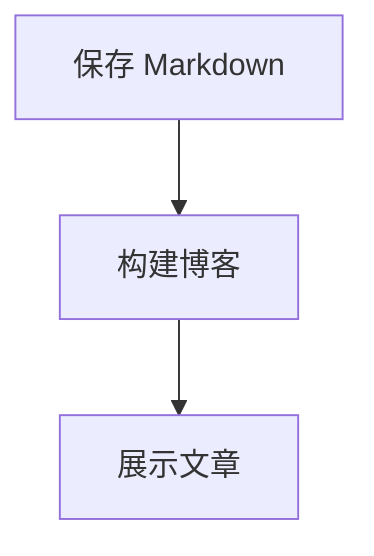

# 内容与配置指南

[返回项目介绍](../README.md) · [内容仓库与写作说明](https://github.com/wzh-devin/devin-blog-content)

## 内容来源

`devin-blog-content/config/site.json` 控制署名、品牌、首页简介和文案；浏览器加载内容后同步页面标题与描述。`timeZone` 用于文章日期（示例值 Asia/Shanghai），首页时钟始终跟随访客浏览器当前时区。`src/config/site.ts` 仅保留兼容导出，不再维护内容。下方通过 [GeoJS](https://www.geojs.io/docs/v1/endpoints/geo/) 按 IP 大致识别城市与国家，不请求精确定位、不显示或持久化经纬度；代理可能影响城市。页面内查询一次、5 秒超时，失败显示“位置暂不可用”且时钟正常；切换网络后刷新更新。文章入口在 `src/features/articles/data.ts`，数据由内容发布流程导出为 JSON，在浏览器运行时读取；类型和筛选在同目录的 `model/` 中。初始化时请按实际资料填写署名与联系方式。

### 内容目录与发布位置

| 内容仓库位置                        | 网站位置                               |
| ----------------------------------- | -------------------------------------- |
| `posts/development/<slug>/index.md` | `/writing/<slug>`，归档“开发”分类      |
| `posts/design/<slug>/index.md`      | `/writing/<slug>`，归档“设计”分类      |
| `posts/thoughts/<slug>/index.md`    | `/writing/<slug>`，归档“随想”分类      |
| `config/site.json`                  | 品牌、署名、首页两行介绍与最近文章文案 |
| `config/navigation.json`            | Menu 左侧导航、顺序与显隐              |
| `config/menu.json`                  | Menu 右侧介绍、链接与页脚              |
| `pages/about/index.md`              | `/about` 正文、标题、提示与链接        |
| `pages/work/index.json`             | `/work` 项目列表                       |
| `pages/uses/index.json`             | `/uses` 工具列表                       |
| `pages/links/index.json`            | `/links`，分组链接列表                 |
| `pages/<slug>/index.md`             | 新的 `/<slug>` 独立页面                |
| `config/categories.json`            | Archive 分类筛选，数组顺序就是显示顺序 |
| `config/featured.json`              | 首页圆环精选，按文章日期排列           |
| `drafts/`                           | 不读取、不输出页面或配图               |

每篇文章的 `index.md` 开头填写 `title`、`date: "YYYY-MM-DD"`、`description`，正文使用 Markdown。配图放在本篇目录内，以 `` 引用。独占一段的配图下方会自动显示原始文件名与后缀（例如 `example.webp`），不显示构建哈希；内联图片保持原样。远程配图按 URL 路径提取文件名，不读取查询参数。文章间可使用指向另一个已发布 `index.md` 的相对链接，构建时会转换为 `/writing/<slug>`；其他站内页面使用 `/archive` 等绝对站内路径。原始 HTML 和 JSX 作为文字显示，不执行脚本。

新增分类时，在 `categories.json` 添加 `{ "id": "reading", "label": "阅读" }`，再将文章放到 `posts/reading/<slug>/index.md`。网站自动添加“全部”并保留空分类；全站菜单单独通过 `config/navigation.json` 维护，不影响文章分类。

文章按发布日期降序展示，首页和 Writing 取最近三篇。圆环清单只引用已发布文章，最多六篇；移除精选不会删除文章。阅读时长按正文字符数估算。移回草稿前，先删除对应精选引用。

无效 JSON/YAML、重复文章标识、错误日期、未登记分类、失效精选和越界或缺失配图会明确报错并阻止内容发布；不会回退到旧示例数据。没有已发布文章时允许空列表。

正文的 `##`、`###` 等标题会自动进入“本文目录”，按实际标题层级嵌套缩进，点击后定位到对应标题；跳级时归入最近的上级标题，不补造空章节。

### 站点配置和独立页面

配置模板见下方“内容仓库初始化模板”，详细目录与字段说明见 [内容仓库 README](https://github.com/wzh-devin/devin-blog-content/blob/main/README.md)。网站只读取内容仓库中的 `config/` 与 `pages/`，不内置另一份配置，也不在运行时解析说明文档。站点、导航、菜单和内置页面文件必须存在；缺少必要文件或字段会阻止内容导出并指出位置；浏览器请求失败显示重试入口，不使用内置示例。

允许显式清空：`navigation.json` 为 `[]` 隐藏全部菜单，`sectionList: []` 清空页面分组，`entryList: []` 清空分组条目，`linkList: []` 清空操作链接。条目的 `year`、`linkList` 和 Markdown 的 `description`、`notice`、`linkList` 是可选字段；其余以模板及校验提示为准。

例如新增 `pages/notes/index.md`（frontmatter 填 `title`，可选 `description`、`notice`、`linkList`），再在 `config/navigation.json` 添加 `{ "label": "Notes", "href": "/notes" }`。页面自动映射 `/notes`，不必修改前端路由。设置 `visible: false` 只隐藏菜单；已有页面依然可以直接访问。可见项按数组顺序自动编号，菜单名称与页面标题独立。

About 与自定义页面使用 Markdown，图片放在自身目录中；Work/Uses/Links 共用 JSON 列表模板。每个条目支持可选 `linkList: [{ label, href }]`，可同时展示官网、下载等多个链接，支持安装包直链；省略或 `[]` 保持纯名称和描述。Markdown 正文里的相对页面/文章链接会自动映射网站路径；配置中的链接使用 `/about` 等站内绝对路径或 HTTP(S)、mailto、tel。系统路径 `/`、`/writing`、`/archive`、`/writing/:slug` 和资源目录不能被自定义页面占用；`about`、`work`、`uses`、`links` 分别使用规定格式。

无效配置、未知字段、危险链接、失效站内配置链接、页面冲突会包含文件位置并阻断内容导出。保存/新增/删除配置、页面和配图后，开发服务自动刷新；线上由内容仓库工作流独立发布，刷新页面后读取最新索引。

### 代码高亮与 Mermaid 图表

正文继续使用 `markdown-to-jsx`。`highlight.js` 和 `beautiful-mermaid` 仅在内容导出端运行，不进入浏览器 JavaScript；无需 CDN 或在线图表服务。

代码围栏标明语言即可高亮，例如 `typescript`、`ts`、`javascript`、`json`、`bash`、`go`、`python`、`sql` 等 common 构建支持的语言；无语言或未知语言保持纯文本。代码块右上角显示语言名（未标记时为 `text`）和“复制”按钮，复制原文并保留缩进与换行；成功显示“已复制”，失败可重试。复制使用浏览器 Clipboard API，需要 HTTPS 或 localhost。代码块沿用网站现有字体、背景、间距和主题色。

使用 Mermaid 围栏可以生成图表：

````markdown

````

当前支持流程图、状态图、时序图、类图、ER 图和 XY 图表，采用 `beautiful-mermaid` 支持的 Mermaid 语法子集。图表生成浅色/深色两份透明 SVG，随网站主题显示；右上角标记 `mermaid` 并可复制图表源码，源码不在页面展开。这是静态图表，不执行图表里的交互脚本。语法有误或类型不支持时会提示并保留源码，不影响其余正文。图表与配图共用内容摘要、开发监听和生产资源输出。

Work、Uses、Links 的 JSON 结构完全相同：`{ title, introduction, sectionList: [{ title, entryList: [{ name, description, year?, linkList? }] }] }`。三个页面使用相同的字段结构，不接受 `projectList`、`toolList` 或单独 `href`。`year` 可选，未配置不显示；`linkList` 可包含多个官网、下载、源码或演示入口。

### 使用其他内容目录

默认路径为 `../devin-blog-content`。其他位置可在网站根目录的 `.env.local` 中设置：

```dotenv
BLOG_CONTENT_DIR=/absolute/path/to/devin-blog-content
```

相对路径以博客代码仓库根目录为基准。这个变量用于开发和 `content:build`，不进入浏览器；修改后重启开发服务。网站生产构建不要求该目录存在，文章和配图仅输出到 `content-dist/`，不会进入 `dist/` 或网站镜像。线上只保留生成文件，不保存源码仓库或 GitHub 凭据。

树影资源来源见[资源说明](../public/ASSETS.md)；字体为自托管的 Geist，不需要运行时远程字体服务。没有复制参考作者的 Logo 或文章。

## 内容仓库初始化模板

初始化模板统一在本文维护，复制到 `devin-blog-content` 中对应的位置后编辑。实际配置只由内容仓库管理，网站代码没有内容回退文件。Work、Uses、Links 的结构相同，下面只展示各自内容的区别。

### `config/site.json`

```json
{
  "name": "Devin",
  "siteName": "Devin, my blog.",
  "description": "关于开发、设计，以及生活里那些微小的发现。",
  "introLineList": ["记录关于代码、设计与生活，", "把一路上的探索、想法，慢慢写下来。"],
  "timeZone": "Asia/Shanghai",
  "home": {
    "recentTitle": "Recent writing",
    "viewAllLabel": "View all"
  }
}
```

### `config/navigation.json`

```json
[
  {
    "label": "Home",
    "href": "/"
  },
  {
    "label": "About",
    "href": "/about"
  },
  {
    "label": "Work",
    "href": "/work"
  },
  {
    "label": "Uses",
    "href": "/uses"
  },
  {
    "label": "Writing",
    "href": "/writing"
  }
]
```

### `config/menu.json`

```json
{
  "eyebrow": "A little hello",
  "title": "Keep in touch",
  "description": "这个小站记录关于开发、设计与日常的想法。你可以从一篇文字开始，慢慢认识这里。",
  "linkList": [
    {
      "label": "Writing",
      "href": "/writing"
    },
    {
      "label": "About",
      "href": "/about"
    }
  ],
  "footer": {
    "label": "Last updated",
    "text": "Copyright / {year}"
  }
}
```

### `pages/about/index.md`

```markdown
---
title: About
description: 写代码，也写一些文字。对如何把东西做好，始终保持好奇。
linkList:
  - label: Explore my writing
    href: /writing
---

写代码，也写一些文字。对如何把东西做好，始终保持好奇。

这个博客用来记录开发中的思考、设计里的小细节，以及日常生活中偶然发现的美好。不追逐热点，也不急着给出标准答案。

## A little space on the internet

希望这里像一张靠窗的书桌：简单、安静，有一点阳光。打开一篇文章，就能安心读一会儿。

比起完整的结论，更想保留探索的过程。那些想明白的、还没想明白的，都可以在这里慢慢展开。
```

### `pages/work/index.json`

```json
{
  "title": "Work",
  "introduction": "一些正在构建的东西，从想法开始，在细节里慢慢成形。",
  "sectionList": [
    {
      "title": "Current project",
      "entryList": [
        {
          "year": "2026",
          "description": "这个小站。用 Vite、TypeScript 与 Tailwind CSS 搭建，记录技术、设计与日常思考。",
          "linkList": [
            {
              "label": "查看项目",
              "href": "/archive"
            }
          ],
          "name": "Devin, my blog."
        }
      ]
    }
  ]
}
```

### `pages/uses/index.json`

```json
{
  "title": "Uses",
  "introduction": "让这个小站运行起来的工具。保持简单，把精力留给内容。",
  "sectionList": [
    {
      "title": "Built with",
      "entryList": [
        {
          "name": "Vite",
          "description": "开发服务与静态构建。",
          "linkList": [
            {
              "label": "官网",
              "href": "https://vite.dev/"
            }
          ]
        },
        {
          "name": "TypeScript",
          "description": "让内容、路由和交互有清楚的类型约定。",
          "linkList": [
            {
              "label": "官网",
              "href": "https://www.typescriptlang.org/"
            }
          ]
        },
        {
          "name": "Tailwind CSS",
          "description": "布局工具类与主题样式。",
          "linkList": [
            {
              "label": "官网",
              "href": "https://tailwindcss.com/"
            }
          ]
        },
        {
          "name": "Geist",
          "description": "自托管的 Sans 与 Mono 字体。",
          "linkList": [
            {
              "label": "官网",
              "href": "https://vercel.com/font"
            },
            {
              "label": "下载",
              "href": "https://github.com/vercel/geist-font/releases"
            }
          ]
        }
      ]
    }
  ]
}
```

### `pages/links/index.json`

```json
{
  "title": "Links",
  "introduction": "一些常去的地方，和想留下的链接。",
  "sectionList": [
    {
      "title": "阅读与探索",
      "entryList": [
        {
          "name": "GitHub",
          "description": "代码和开源项目。",
          "linkList": [
            {
              "label": "官网",
              "href": "https://github.com/"
            }
          ]
        },
        {
          "name": "MDN Web Docs",
          "description": "Web 开发参考。",
          "linkList": [
            {
              "label": "官网",
              "href": "https://developer.mozilla.org/zh-CN/"
            }
          ]
        }
      ]
    },
    {
      "title": "在这里",
      "entryList": [
        {
          "name": "最近的文字",
          "description": "看看最近写下的文章。",
          "linkList": [
            {
              "label": "阅读",
              "href": "/writing"
            }
          ]
        },
        {
          "name": "关于这个小站",
          "description": "从一段介绍开始认识这里。",
          "linkList": [
            {
              "label": "了解更多",
              "href": "/about"
            }
          ]
        }
      ]
    }
  ]
}
```
